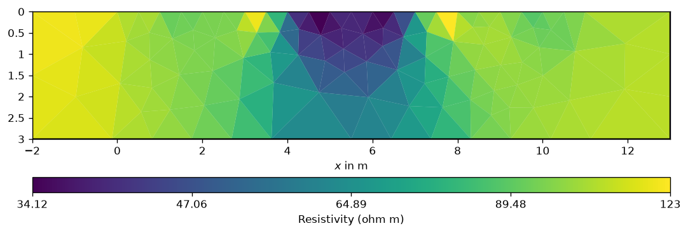

# Validation of the bundled source

Verified with Python 3.12.14 on the managed Linux workspace, using upstream
PyHydroGeophysX v0.3.0 commit
`311b1b4c87ede8aabdf6a7a38d4f05d992d20298` and pyGIMLi 1.6.1.

- All **579 retained upstream files** matched their original Git blob hashes.
  `provenance.json` lists them and the 583 omitted files (datasets, checkpoints, and the credential-containing notebook).
- `bash setup.sh` installed the bundled editable source into an isolated
  environment, passed `pip check`, byte-compiled all package modules, and built
  `dist/pyhydrogeophysx-0.3.0-py3-none-any.whl` (645,795 bytes for this build).
- The wheel was installed separately into a temporary target, and its package
  and `ERTInversion` imported from that target successfully.
- **20 upstream tests passed**: interpolation, petrophysics, and I/O utilities.
  The result is saved in [validation/tests.txt](validation/tests.txt).
- `run_ert_example.py --output validation/ert` imported the bundled source and
  completed a CPU ERT inversion: 12 electrodes, 18 Wenner observations, and
  173 model parameters. Initial log-data chi-squared was **491.038132**;
  final chi-squared was **0.033139**, with relative RMS **0.404931%**.
- Checks covered model/data shapes, finite positive responses, resistivity
  bounds, finite nonzero sensitivities, improved fit, and preservation of
  assigned 0.5–3% errors. Both misfit and exports use the final response.

Saved [metrics](validation/ert/summary.json), [data fit](validation/ert/data_fit.csv),
[model](validation/ert/model.csv), [VTK](validation/ert/model.vtk), and
[input survey](validation/ert/synthetic.ohm) accompany the figure below.
This small noiseless synthetic example verifies installation and numerical
operation; it does not establish a unique recovered geological model.
GUI, time-lapse, joint, and EM inversions were not exercised by these checks.



## Repeat the checks

From this folder:

```bash
bash setup.sh
.venv/bin/python run_ert_example.py
.venv/bin/python -m pip install pytest==9.1.1
XDG_CONFIG_HOME="$PWD/.cache/config" XDG_CACHE_HOME="$PWD/.cache" \
  MPLCONFIGDIR="$PWD/.cache/matplotlib" .venv/bin/python -m pytest -q \
  source/tests/test_interpolation.py source/tests/test_petrophysics.py \
  source/tests/test_io_utils.py
```

The GitHub Actions workflow builds the source and wheel and runs the synthetic
ERT check on pull requests and relevant main-branch pushes. It uploads the
generated wheel and ERT outputs as a downloadable run artifact. Environments,
build caches, and `dist/` remain local/generated rather than source-controlled.
