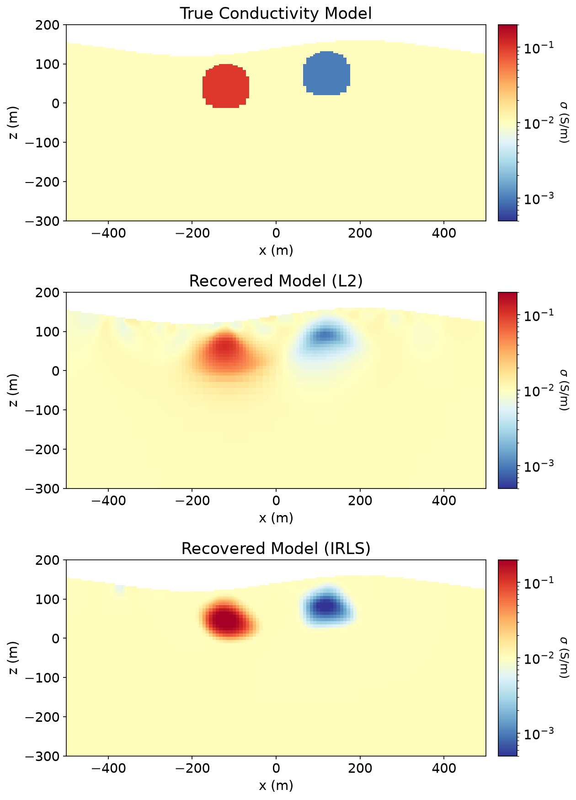
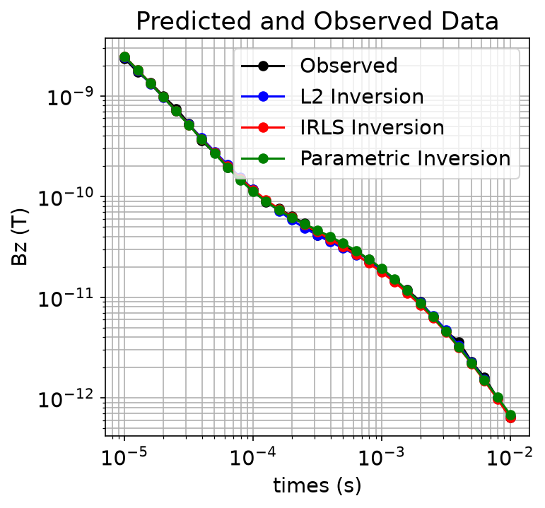
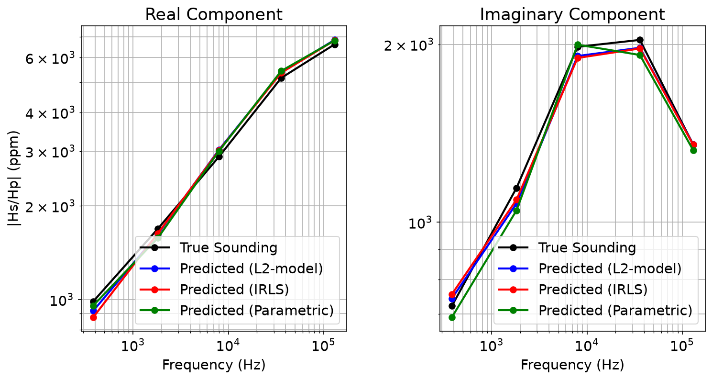
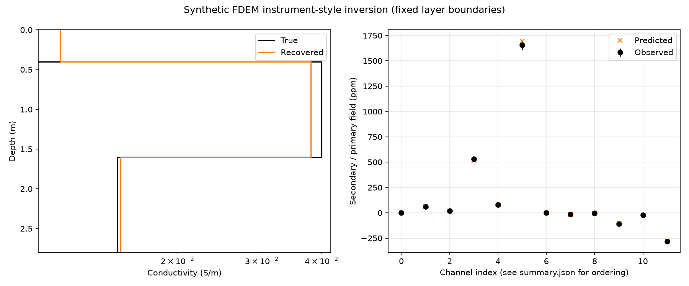
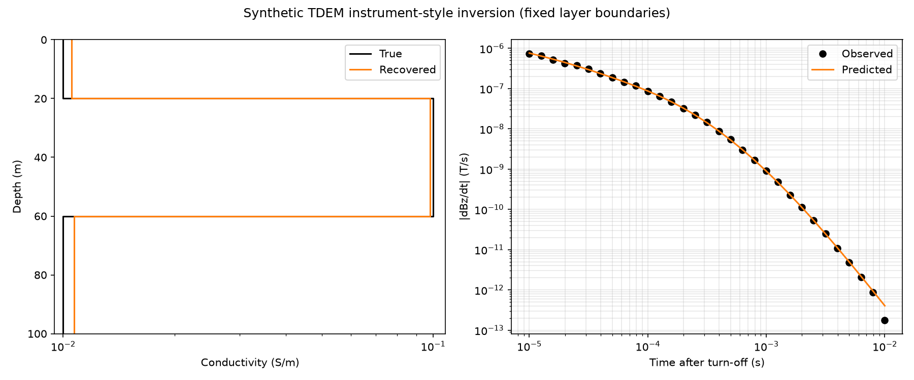

# SimPEG installation and inversion test report

Completed 2026-10-12 (America/Los_Angeles) in `/workspace/AI-ERT-EM/SimPEG`, in the connected Linux cloud workspace.

**All five examples completed, covering ten successful inversions.** All saved models/predictions are finite, all fits improved over their starting models, and final weighted RMS values are 0.85–1.01. Eight upstream Jacobian tests passed. The source installation, dependency check, byte-compilation, and wheel build passed.

## Measured inversion results

| Inversion | Data | Parameters | Starting WRMS | Final WRMS | Iterations |
| --- | ---: | ---: | ---: | ---: | ---: |
| ERT 2.5D, smooth conductivity | 135 | 7205 | 18.099 | 0.987 | 5 |
| ERT 2.5D, sparse resistivity | 135 | 7205 | 18.227 | 1.009 | 50 |
| TDEM 1D, smooth | 31 | 36 | 12.086 | 0.938 | 13 |
| TDEM 1D, sparse | 31 | 36 | 12.086 | 0.967 | 85 |
| TDEM 1D, parametric | 31 | 5 | 14.547 | 0.942 | 34 |
| FDEM 1D, smooth | 10 | 40 | 5.346 | 0.851 | 10 |
| FDEM 1D, sparse | 10 | 40 | 5.346 | 1.003 | 12 |
| FDEM 1D, parametric | 10 | 5 | 5.357 | 0.969 | 16 |
| FDEM 30 kHz, multi-coil demo | 12 | 3 | 4.539 | 0.967 | 3 |
| TDEM finite-waveform dB/dt demo | 31 | 3 | 17.592 | 0.900 | 4 |

WRMS is the root mean square of residuals divided by their assigned standard deviations. Values around one represent fits at the assigned error level. The observations are synthetic; these runs do not assess field-data quality or model uniqueness.

The sparse ERT inversion reached the tutorial's 50-iteration limit, with WRMS 1.009, just above the strict target of 1.0. It completed normally and improved the fit substantially; it did not satisfy the strict target before the limit. Other tutorials stopped according to their usual target/convergence directives. The eight Jacobian checks verify the EM sensitivities used by inversion; the complete SimPEG test suite was not run.

## What ran

- **ERT:** Official 2.5D DC resistivity tutorial with topography and conductive/resistive targets; 135 observations and 7,205 active model cells. Smooth conductivity inversion and sparse apparent-resistivity inversion. [Results](results/ert/summary.json), [console log](logs/ert.log).
- **TDEM:** Official 1D central-loop sounding tutorial; a 10 m radius loop at 1 m height, 1 A current, step-off excitation, and vertical B-field observations. Smooth, sparse, and five-parameter layered inversions. [Results](results/tdem/summary.json), [console log](logs/tdem.log).
- **FDEM:** Official 1D multi-frequency sounding tutorial; vertical magnetic dipole at 30 m height, 10 m receiver offset, in-phase/quadrature secondary field in ppm. Smooth, sparse, and five-parameter layered inversions. [Results](results/fdem/summary.json), [console log](logs/fdem.log).
- **Shallow multi-coil FDEM:** Additional 30 kHz synthetic example with 0.32/0.71/1.18 m separations, 0.25 m height, two coplanar orientations, and both real/imaginary channels. Three conductivities inverted with fixed layer boundaries. [Results](results/fdem_instrument_style/summary.json).
- **Finite-waveform TDEM:** Additional airborne circular-loop example at 30 m height, with 20 microsecond ramp-off and vertical dB/dt samples from 10 microseconds to 10 milliseconds. Three conductivities inverted with fixed layer boundaries. [Results](results/tdem_instrument_style/summary.json).

The extra examples demonstrate features relevant to CMD Mini-Explorer and tTEM/SkyTEM, but their illustrative geometries are not calibrated commercial system definitions. Actual gates are represented by time samples, not window averages. Actual instrument files have not been imported.

## Figures

ERT true model and both recovered models:

Official TDEM observed and predicted data:

Official FDEM observed and predicted data:

Additional shallow FDEM model and data fit:

Additional finite-waveform TDEM model and data fit:

## Reproducibility and provenance

- Python 3.12.14; SimPEG 0.25.2.
- SimPEG source tag `v0.25.2`, commit `5f2d643c484ebe8b8ccfa029aa7377d133f2f53f`.
- Official user tutorials commit `d817cbf587605940d9125d4308a05c88610335e9`.
- Wheel SHA-256: `58b170008f4be21f12a767bdaae0b795d703a052c096c9047563c2fb05529e5d`.
- Installed dependency versions: [requirements-lock.txt](requirements-lock.txt).
- Build metadata: [provenance.json](provenance.json).
- Validation: [saved-array checks](logs/results-verification.log), [Jacobian checks](logs/jacobian-tests.log), [wheel build](logs/wheel-build.log), [installation](logs/install.log).

The runner extracts the official notebook code, uses the identical data archives from the pinned local checkout, seeds beta estimation with 42, records inversion outputs, and saves plots without a GUI. It corrects three upstream TDEM conductivity-axis labels that said resistivity. Its original code exports are retained alongside the runnable local exports. Physics, mesh sizes, regularization, optimization, and iteration limits were preserved.

The ERT solver is SciPy's sparse LU through pymatsolver. It produced performance/sparse-format warnings but completed successfully. No optional Pardiso or MUMPS installation was needed for these examples. Published native dependency wheels were used; SimPEG's own built wheel is pure Python.

To run again, see [README.md](README.md), or execute `bash run_all.sh` from this directory. All numerical arrays, CSV exports, PNG figures, input files, and per-run summaries are retained under `results/`.

Source links: [SimPEG](https://github.com/simpeg/simpeg/tree/v0.25.2), [ERT tutorial](https://github.com/simpeg/user-tutorials/blob/d817cbf587605940d9125d4308a05c88610335e9/notebooks/05-dcr/inv_dcr_2d.ipynb), [TDEM tutorial](https://github.com/simpeg/user-tutorials/blob/d817cbf587605940d9125d4308a05c88610335e9/notebooks/08-tdem/inv_tdem_1d.ipynb), [FDEM tutorial](https://github.com/simpeg/user-tutorials/blob/d817cbf587605940d9125d4308a05c88610335e9/notebooks/07-fdem/inv_fdem_1d.ipynb).
