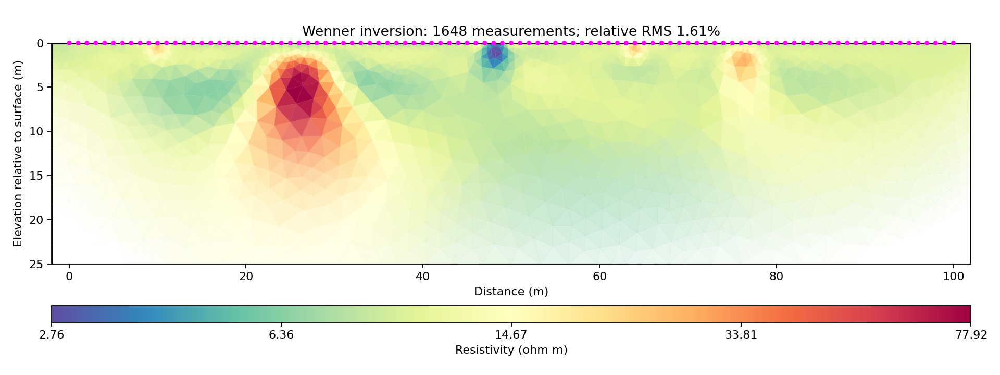

# Wenner32 inversion with pyGIMLi

Run from the repository root after installing its requirements:

```bash
python examples/wenner_2d/invert_wenner.py
```

The script uses pyGIMLi 1.6.1's `ert.ERTManager` for a smooth 2D inversion on a flat surface. It explicitly converts all 1,648 RES2DINV rows to a `DataContainerERT` and saves `inversion_results/wenner32.ohm` in pyGIMLi's native format. The 101 reconstructed electrodes span 0–100 m.

For midpoint x and spacing a, electrode positions are A=x−1.5a, M=x−0.5a, N=x+0.5a, B=x+1.5a. The script checks the geometric factors against 2πa and verifies the saved data can be reloaded without dropping any measurements. Explicit conversion also avoids the first-row skipping issue in the RES2DINV importer in the bundled source snapshot.

Settings: assumed 3% relative measurement error, initial regularization lambda 20, parameter depth 25 m, maximum parameter cell area 4 m², and at most 15 iterations. Errors are assumed because the source file supplies none. Override the error and regularization with `--relative-error` and `--lam`.

Outputs:

- `inversion.png`: recovered resistivity cross-section.
- `summary.json`: fit statistics, model range, settings, and chi-squared history.
- `wenner32.ohm`: converted survey, geometric factors, and assumed errors.
- `model.csv`: cell-center coordinates (positive depth downward) and recovered resistivity.
- `data_fit.csv`: observed and predicted apparent resistivity with residuals.
- `model.vtk`: model mesh and resistivity, readable in ParaView.



This is a regularized interpretation under the stated error and flat-surface assumptions. Deep and edge features have weaker constraints; the plotted mesh depth is not a demonstrated depth of investigation. A low chi-squared value does not prove the geological interpretation is unique.

Source and upstream license: see [../README.md](../README.md) and [../LICENSE-ResIPy.txt](../LICENSE-ResIPy.txt).
